# A250 — Mechatronics Project

This project uses a Snapmaker A250 as a programmable mechatronics platform. A Raspberry Pi 5 runs the Python vision and experiment software, a stereo USB camera observes the work area, and an HDMI projector displays feedback on the bed. Klipper/Moonraker and a custom STM32H723/STM32G431 controller connect the software to the machine electronics.

<p align="center">
  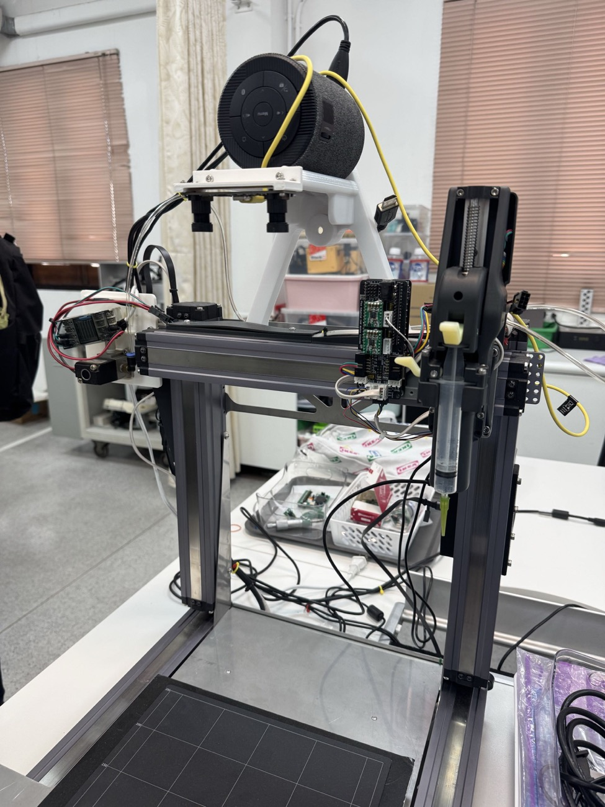
</p>

The course brief calls for a small system combining mechanics, interface electronics, a Raspberry Pi Pico, and Python. This implementation uses a Raspberry Pi 5 rather than a Pico; that platform difference should be addressed in the final report.

## Main components

- **Snapmaker A250:** provides the XYZ motion platform and work area.
- **Raspberry Pi 5:** runs the Python experiments, vision processing, and local web console.
- **Stereo USB camera:** captures the work area for calibration, object detection, and tracking.
- **HDMI projector:** displays calibration patterns, markers, outlines, and interactive graphics on the bed.
- **Custom dual-MCU controller:** STM32H723 handles motion signals while STM32G431 provides the gateway path to the machine interface.
- **Klipper and Moonraker:** provide the machine-control software interface used by the Pi.

## Project work

- Calibrate camera-to-projector alignment and map image coordinates to the work area.
- Detect and track objects, including a machine bracket, and project markers or object outlines.
- Demonstrate fingertip-controlled projected tic-tac-toe.
- Provide a local web page for camera preview and machine status, with guarded XYZ jog controls.

## Connect to the Raspberry Pi over SSH

Connect your computer to the **Mechatronics** Wi-Fi network, then open a terminal and connect to the Pi with the recorded account and address:

```sh
ssh cps@192.168.31.187
```

At the password prompt, type the Pi account password and press Enter. The password is not shown as you type. On the first connection, SSH may ask you to verify the host key; compare its fingerprint with a trusted record for the Pi before accepting. When connected, the shell prompt will be on the Pi. Type `exit` to disconnect.

If the connection times out, confirm the Pi is powered on and both devices are on the **Mechatronics** network; the Pi address may have changed. Do not put the password in the command, a script, or this repository.

## Experiment highlights

### Camera-projector calibration

The calibration experiment projected targets onto the bed and matched their camera positions to projector coordinates. The saved calibration reported 8 homography inliers and 1.37 px mean error.

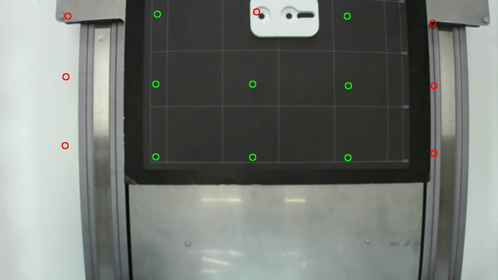

### XYZ motion checks

The November 4 session checked axis directions and swept the bed through Y positions while observing the target by camera. These frames show the workpiece at two points in that Y sweep.

| Around Y=140 | Around Y=240 |
| --- | --- |
| 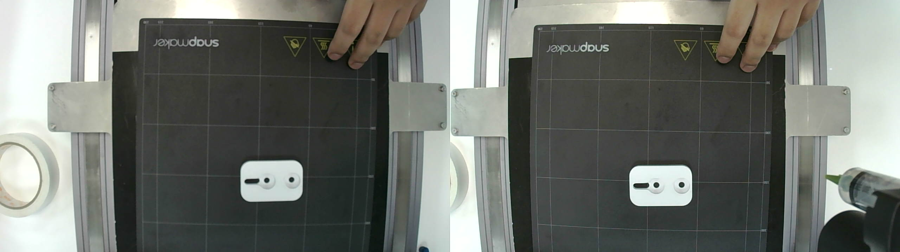 | 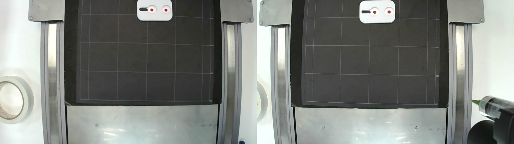 |

The session log also records Z-height changes and the X/Y/Z direction observations. These are historical checks, not proof that current motion is safe.


### Object-hole tracking

The vision pipeline detects the two circular holes in the workpiece and projects markers onto their centers. The debug image shows the detected object box and both hole targets. In the linked clip, the workpiece is repositioned by hand while the projected targets update.

**Camera view during hole tracking**

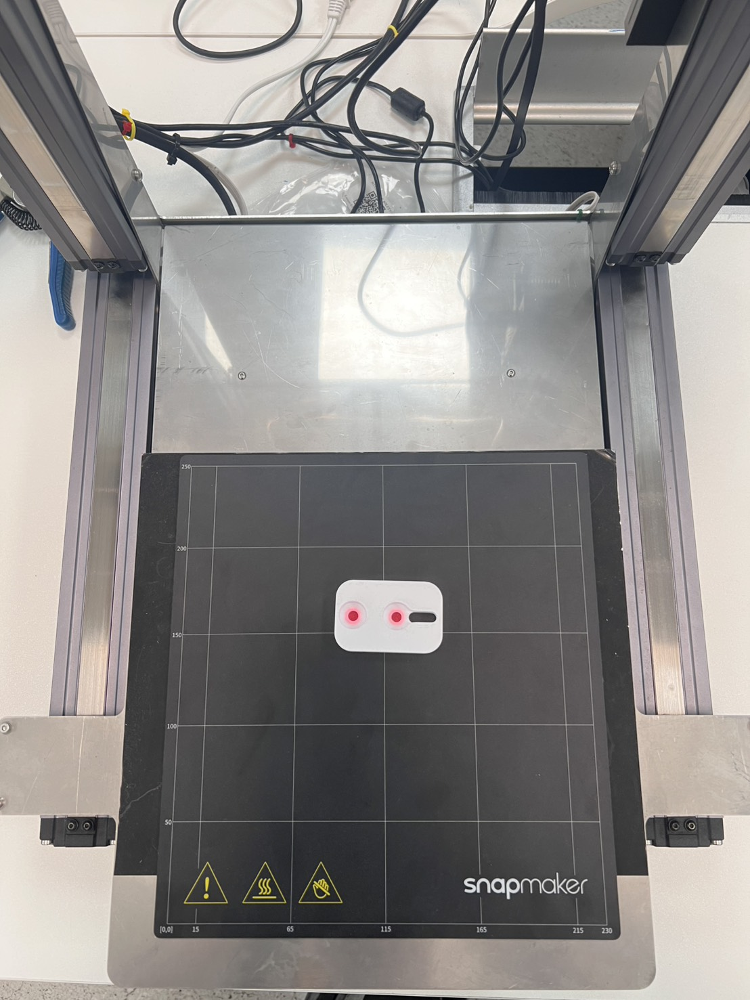

**Tracking output**

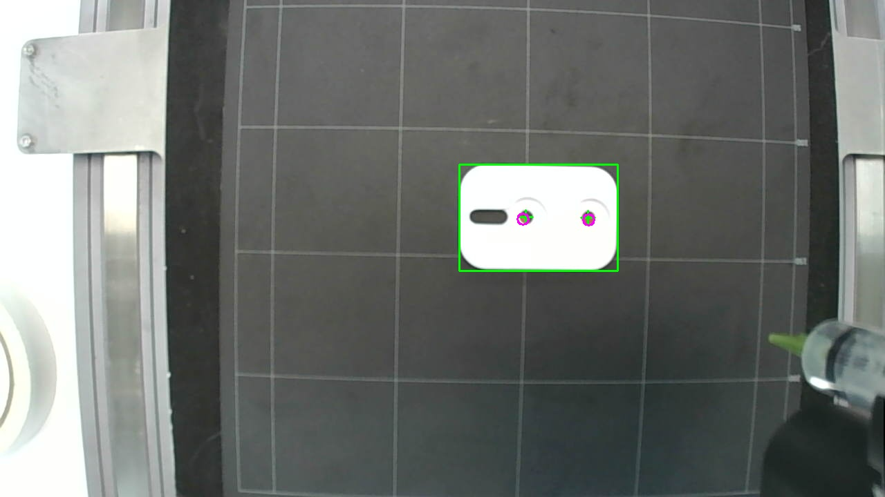

[Video of hole tracking](experiment/A250_session_2026-11-04/video/815476624.458707.mp4)

### Object detection and projected outline

The vision script segments an object against the dark bed and draws its detected contour back into the projected workspace. The saved view shows the outline around a bracket.

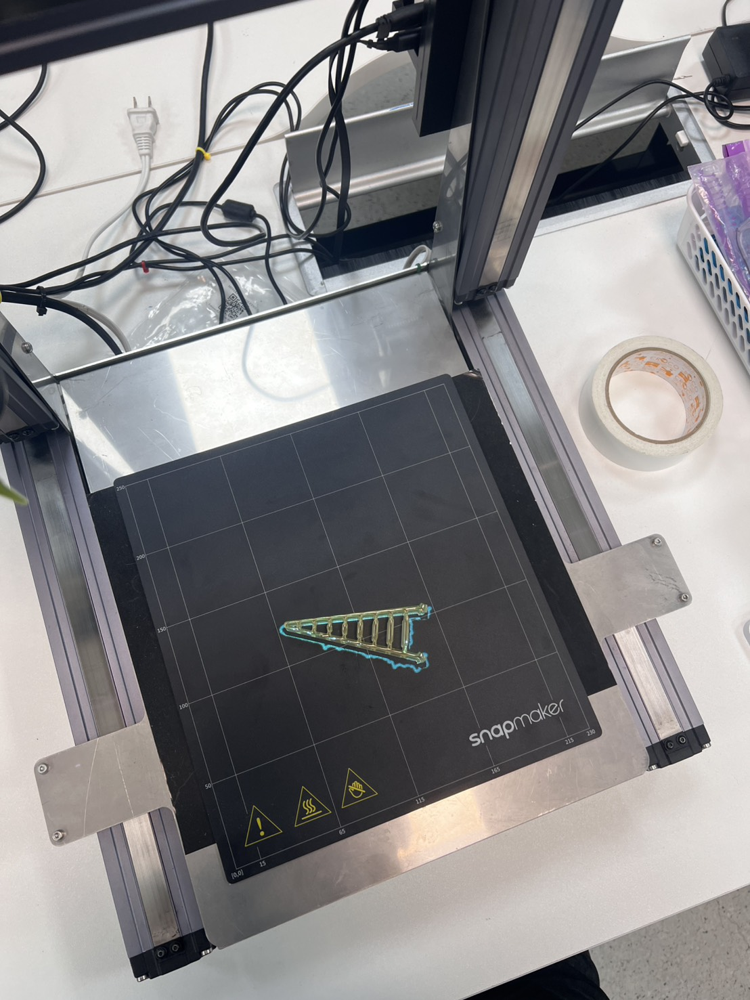

[Video of projected object outlines](experiment/A250_session_2026-11-04/video/815479158.467749.mp4)

### Fingertip-controlled tic-tac-toe

The camera tracks a fingertip over a projected grid, allowing a player to select a cell while the projector displays the board and marks.

| Fingertip selecting a cell | Projected game board |
| --- | --- |
| 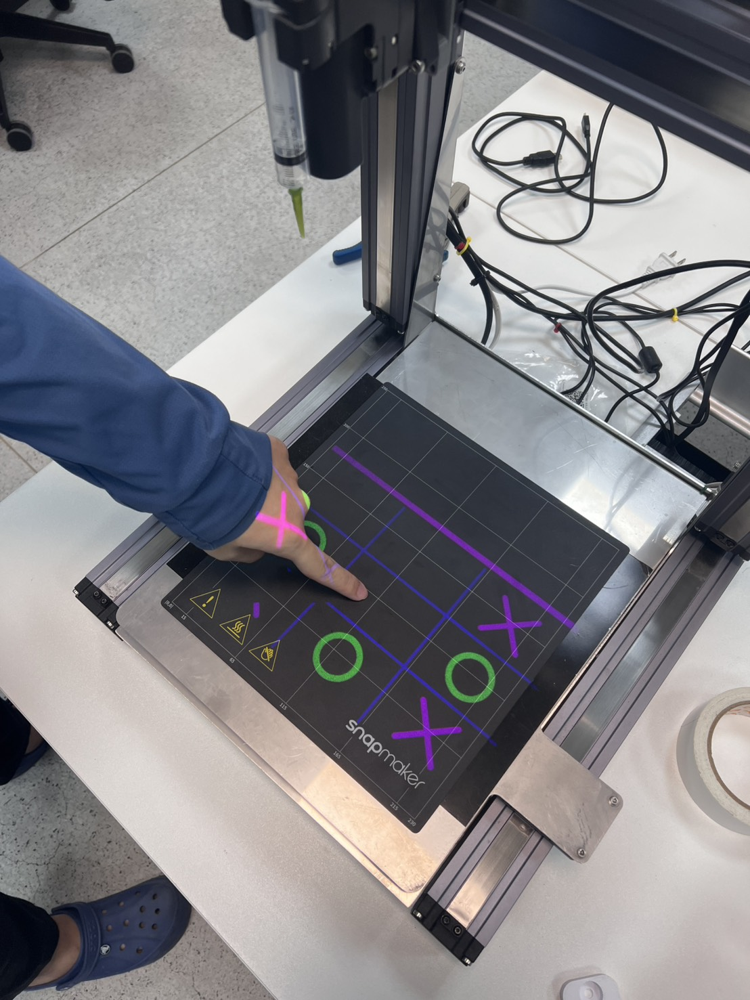 | 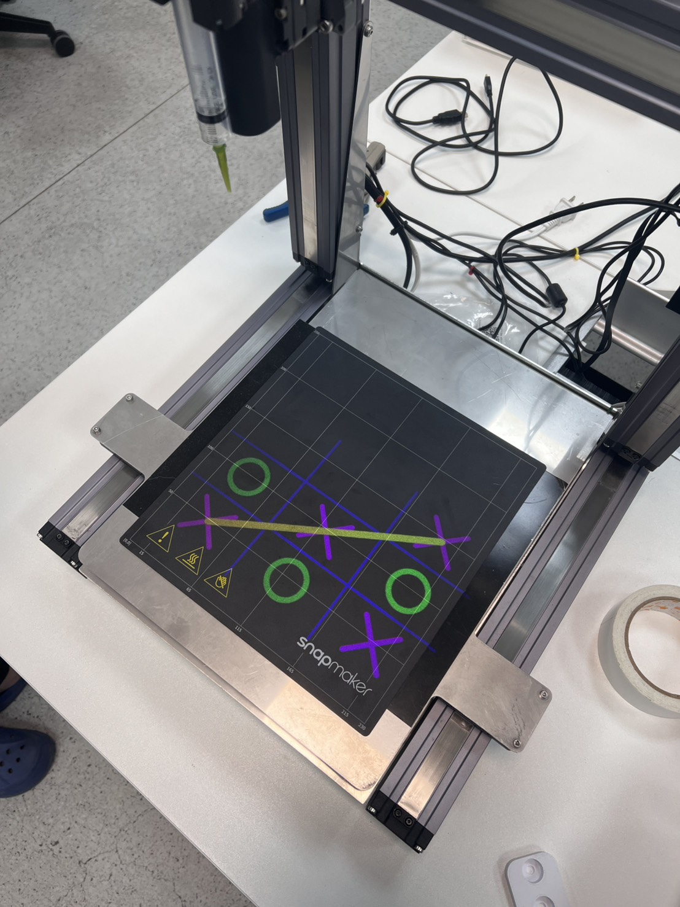 |

[Video of fingertip-controlled tic-tac-toe](experiment/A250_session_2026-11-04/video/815478859.952247.mp4)

The calibration and tracking figures are historical experiment records; they do not certify that machine motion is currently safe.

## Web console example

The local Flask console brings together the stereo camera preview, LAN endpoint, XYZ position and homing state, Klipper status, and guarded jog controls. Jogging is limited to XYZ and remains disabled until the server safety checks pass and a session token is supplied.

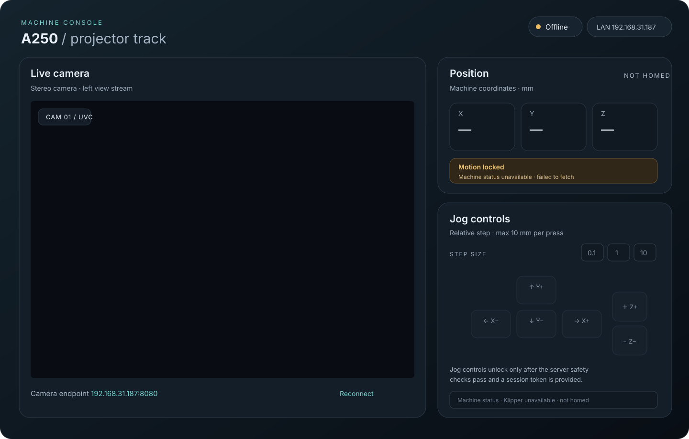

*Offline preview: the Pi and machine endpoint were unavailable when this view was reviewed, so live camera and machine data are not shown.* See the [console setup notes](experiment/A250_session_2026-11-04/machine_web/README.md) and [Flask server](experiment/A250_session_2026-11-04/machine_web/server.py).

## System wiring overview

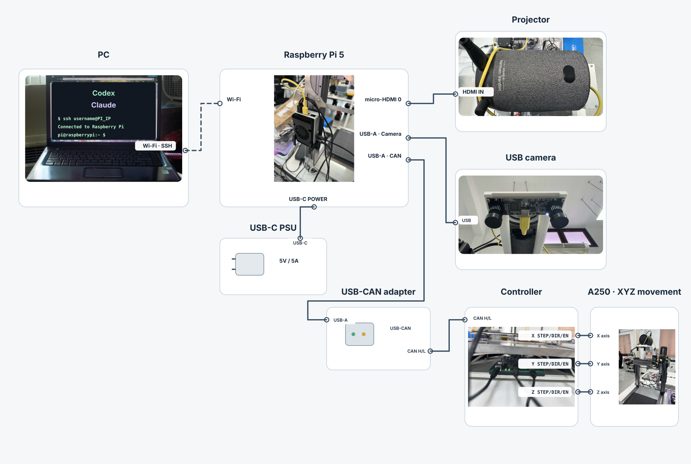

The diagram shows the recorded system connections. Verify the physical wiring before relying on it; controller power, grounds, motor wiring, and connector-level harness details still need an on-machine trace. See the [A250 experiment notes](experiment/A250_session_2026-11-04/A250_REPORT_NOTES.md).

## Course brief and report checklist

The source assignment brief is included at [`docs/Term Project - 2570.pdf`](docs/Term%20Project%20-%202570.pdf). It requests:

- Project rationale and background/related work.
- An overall diagram showing the mechanical system, processor, and interface circuits.
- Commented Python program(s).
- A clip demonstrating the technical features.

The brief asks for four technical requirements selected from its list. We will claim these four:

1. **3D printing:** the Snapmaker A250 supplies the motion platform.
2. **Codex/ChatGPT or Claude:** both were used during project development.
3. **Python packages (select two):** the project uses OpenCV (`cv2`) for camera vision and Flask for the machine web console. Both are named in the brief's package choices.
4. **MQTT/REST API/IoT:** the local web console exposes HTTP endpoints for machine status, camera availability, and guarded jog requests.

The assignment mentions a Raspberry Pi Pico, while this project uses a Raspberry Pi 5; we will state that platform difference in the report.

## Repository contents

- [`experiment/A250_session_2026-11-04/`](experiment/A250_session_2026-11-04/): experiment code, notes, logs, evidence, web console, and wiring diagram.
- [`experiment/A250_session_2026-11-04/SESSION_LOG.md`](experiment/A250_session_2026-11-04/SESSION_LOG.md): experiment sequence and observations.
- [`experiment/A250_session_2026-11-04/A250_REPORT_NOTES.md`](experiment/A250_session_2026-11-04/A250_REPORT_NOTES.md): hardware inventory, wiring notes, references, and report source material.
- [`docs/Term Project - 2570.pdf`](docs/Term%20Project%20-%202570.pdf): original assignment brief.

## Safety status

Machine movement remains locked pending verification of endstop reporting, motor direction, and the temperature sensor. The last recorded state had unhomed axes and an implausible extruder temperature reading. Do not treat historical coordinates or experiment results as evidence that motion is currently safe.
