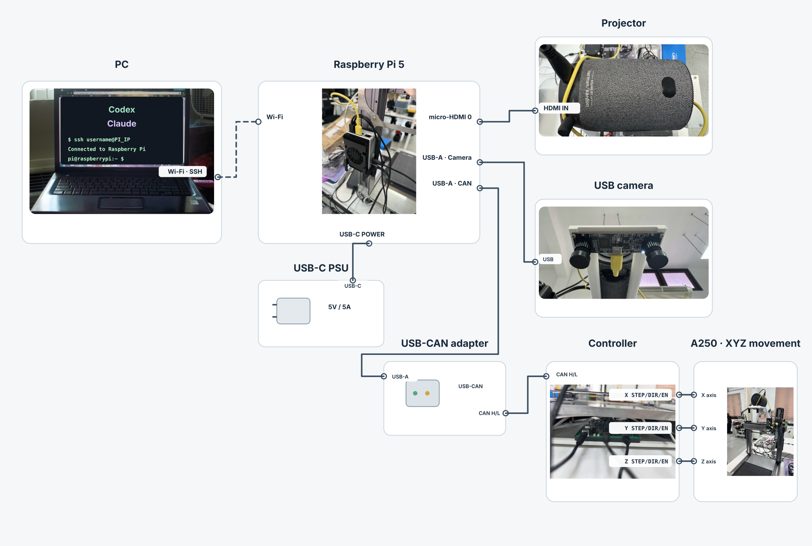

# A250 Mechatronics Project

The Snapmaker A250 is the project’s motion platform. A Raspberry Pi 5 runs the Python vision and experiment software, a stereo USB camera watches the bed, and a projector displays calibrated graphics. Klipper/Moonraker and a custom STM32 controller connect the software to the machine electronics.

## Connect to the Raspberry Pi over SSH

Connect your computer to the **Mechatronics** Wi-Fi network, then open a terminal and connect to the Pi with the recorded account and address:

```sh
ssh cps@192.168.31.187
```

At the password prompt, type the Pi account password and press Enter. The password is not shown as you type. On the first connection, SSH may ask you to verify the host key; compare its fingerprint with a trusted record for the Pi before accepting. When connected, the shell prompt will be on the Pi. Type `exit` to disconnect.

If the connection times out, confirm the Pi is powered on and both devices are on the **Mechatronics** network; the Pi address may have changed. Do not put the password in the command, a script, or this repository.

## Wiring overview



Solid paths show observed or documented signal connections; dashed paths mark expected or unverified wiring. The Pi power input is labeled USB-C 5 V/5 A, but the installed supply cable was not identified. Controller power, grounds, motor wiring, and connector-level harness details still need an on-machine trace.

## What we do

- Calibrate camera-to-projector alignment and map the work area.
- Track a bracket and place projected markers using camera feedback.
- Detect objects and project their outlines.
- Demonstrate fingertip-controlled projected tic-tac-toe.
- Label components in images and estimate their dimensions.
- Provide a LAN page for camera preview and machine status, with guarded XYZ jog controls.

The recorded calibration had 8 homography inliers and 1.37 px mean error; bracket tracking reported about 1 px alignment error in the experiment. These are historical results, not proof that the current machine is safe to move.

## Files

- `pi_projector_track/` and `scripts/`: experiment programs
- `snapshots/`, `video/`, and `logs/`: experiment evidence
- `machine_web/`: camera/status page and interlocked jog interface
- `A250_REPORT_NOTES.md`: wiring, components, references, and machine status

Motion remains locked until the endstops, motor directions, and temperature sensor are verified. See [`SESSION_LOG.md`](SESSION_LOG.md) for the experiment sequence and [`A250_REPORT_NOTES.md`](A250_REPORT_NOTES.md) for hardware details.
